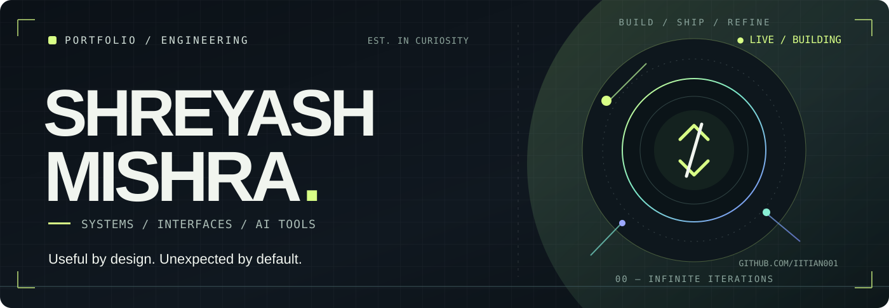

 

  

FULL-STACK ENGINEERING &nbsp; • &nbsp; DEVELOPER TOOLS &nbsp; • &nbsp; LOCAL AI &nbsp; • &nbsp; CREATIVE TECHNOLOGY

 

## 01 / What I make

I like the intersection of **serious engineering** and **memorable experiences**. My work spans developer infrastructure, AI tooling, full-stack products, and interactive web experiences.

<table>
  <tr>
    <td width="50%" valign="top">
      DESIGN SYSTEMS &nbsp; / &nbsp; OPEN SOURCE
      <h3>01. <a href="https://ui.artbloom.tech">ui.artbloom</a></h3>
      A growing library of installable interfaces, templates, and animations, with a registry API and developer CLI.
        
      <code>Next.js</code> <code>TypeScript</code> <code>UI Infrastructure</code>
        
      <a href="https://ui.artbloom.tech">Explore live ↗</a> &nbsp;·&nbsp; <a href="https://github.com/Iitian001/ui-artbloom">Source ↗</a>
    </td>
    <td width="50%" valign="top">
      3D &nbsp; / &nbsp; INTERACTIVE WEB
      <h3>02. <a href="https://room.shreyashmishra.in">The Developer Room</a></h3>
      A portfolio turned into an interactive environment, combining designed spaces, 3D assets, and real-time web graphics.
        
      <code>Three.js</code> <code>Blender</code> <code>WebGL</code>
        
      <a href="https://room.shreyashmishra.in">Enter the room ↗</a>
    </td>
  </tr>
  <tr>
    <td width="50%" valign="top">
      DEVTOOLS &nbsp; / &nbsp; VERIFICATION
      <h3>03. <a href="https://guard.artbloom.tech">Artbloom Guard</a></h3>
      A verification workspace with structured checks and an MCP interface for reproducible tool execution.
        
      <code>MCP</code> <code>TypeScript</code> <code>Testing</code>
        
      <a href="https://guard.artbloom.tech">Explore project ↗</a>
    </td>
    <td width="50%" valign="top">
      CREATIVE PRODUCTS &nbsp; / &nbsp; AI
      <h3>04. <a href="https://artbloom.tech">ArtBloom</a></h3>
      Experiments and products at the edge of generative AI, automation, and creative software.
        
      <code>AI Tools</code> <code>Automation</code> <code>Full Stack</code>
        
      <a href="https://artbloom.tech">Visit ArtBloom ↗</a>
    </td>
  </tr>
</table>

 

## 02 / Merged into the open source I use

**Verified upstream merges only.** Each link goes directly to the merged pull request — no pending PRs or invented achievements.

<table>
  <tr>
    <td width="50%" valign="top">
      REACT &nbsp; / &nbsp; OFFICIAL DOCUMENTATION
      <h3><a href="https://github.com/reactjs/react.dev/pull/8625">React · react.dev</a></h3>
      Added <code>useOptimistic</code> to the Built-in React Hooks overview.
        
      
    </td>
    <td width="50%" valign="top">
      AUTOGPT &nbsp; / &nbsp; PLATFORM UX
      <h3><a href="https://github.com/Significant-Gravitas/AutoGPT/pull/13666">AutoGPT · Platform</a></h3>
      Added <code>Most Recently Ran</code> sorting to the platform library.
        
      
    </td>
  </tr>
</table>

 

## 03 / The toolkit

  

 

## 04 / Where I'm headed

> Build software that earns its complexity — **fast enough to feel effortless, thoughtful enough to be remembered.**

Right now I'm interested in **local-first AI**, **agent infrastructure**, **real-time systems**, and **high-fidelity interfaces**. I'm always up for an ambitious technical problem or a thoughtful open-source collaboration.

 

  <a href="https://shreyashmishra.in">Portfolio</a>
  &nbsp; · &nbsp;
  <a href="https://github.com/Iitian001?tab=repositories">Repositories</a>
  &nbsp; · &nbsp;
  <a href="https://www.linkedin.com/in/shreyashautomation">LinkedIn</a>
  &nbsp; · &nbsp;
  <a href="https://www.kaggle.com/shreyashautomation">Kaggle</a>

    
  DESIGNED TO BUILD. BUILT TO EVOLVE. &nbsp; ◇ &nbsp; SHREYASH MISHRA

